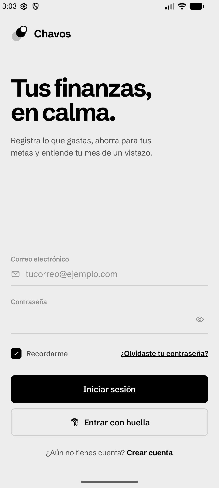
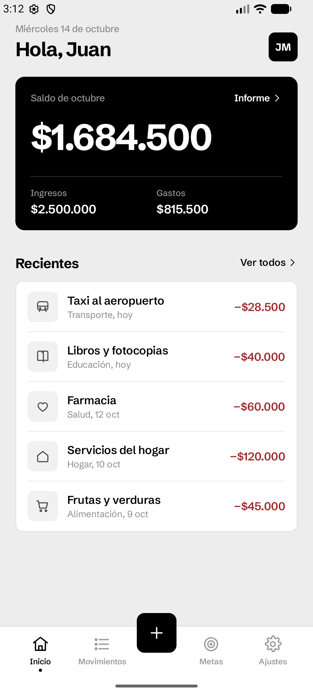
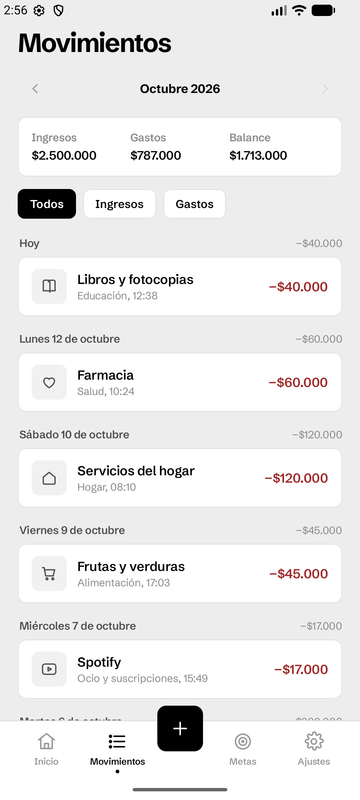
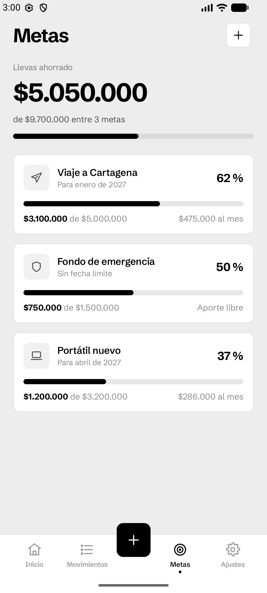
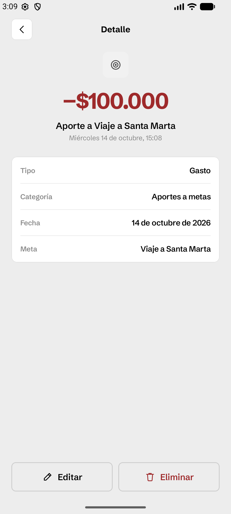
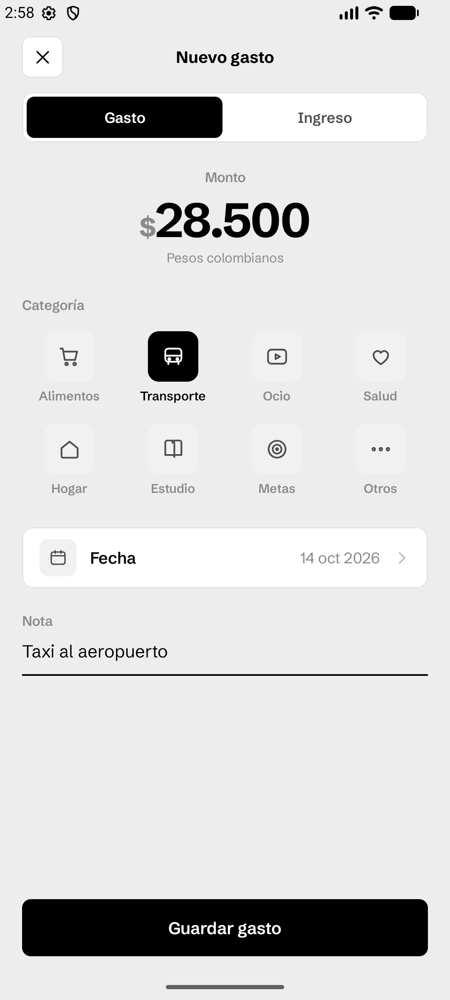
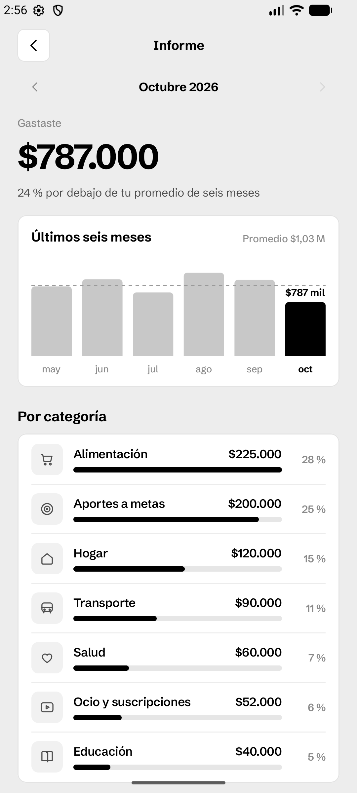
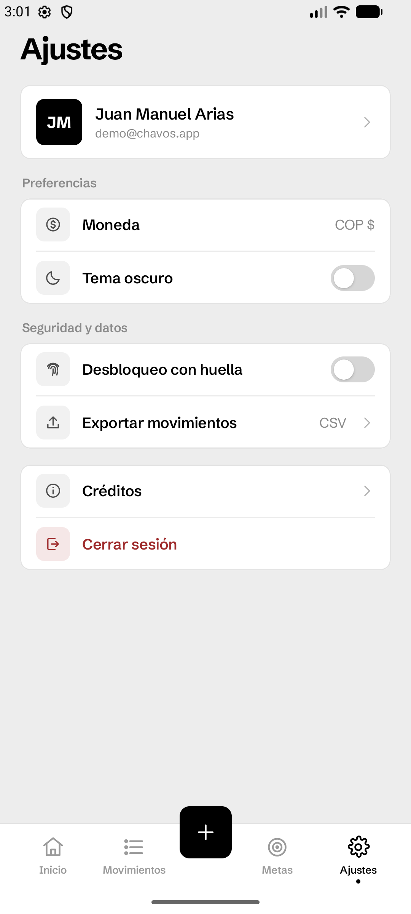

# Chavos

App nativa de finanzas personales para Android, hecha con Kotlin y Jetpack Compose.
Permite registrar gastos e ingresos, ahorrar para metas y ver en qué se va el dinero cada mes.
Todo se guarda en el teléfono: no hay servidor ni cuentas en la nube.

**Entrega 3 · App nativa** — Aplicaciones Móviles, Universidad Pontificia Bolivariana, 2026-2.
Autor: Juan Manuel Arias.

<p>
  
  
  
  
</p>

## Secciones pedidas en la entrega

| Sección | Pantalla en Chavos | Archivo |
|---|---|---|
| Login | Inicio de sesión con correo y contraseña, "Recordarme", ayuda si se olvida la contraseña y entrada con huella | `ui/pantallas/auth/Login.kt` |
| Registro | Creación de cuenta en dos pasos: datos y primera meta (opcional) | `ui/pantallas/auth/Registro.kt` |
| Menú | Barra inferior con Inicio, Movimientos, Metas y Ajustes, más el botón central "+" | `ui/navegacion/Navegacion.kt` |
| Listado | Movimientos del mes agrupados por día, con filtros y resumen | `ui/pantallas/movimientos/Movimientos.kt` |
| Detalle | Detalle de un movimiento, con opciones de editar y eliminar | `ui/pantallas/movimientos/Detalle.kt` |
| Formulario | Nuevo gasto, ingreso o aporte a una meta, y edición de movimientos | `ui/pantallas/movimientos/Formulario.kt` |
| Configuración | Ajustes: perfil, tema oscuro, desbloqueo con huella, exportar CSV, cerrar sesión | `ui/pantallas/ajustes/Ajustes.kt` |
| Créditos | Autor, universidad, curso, periodo y tecnologías | `ui/pantallas/ajustes/Creditos.kt` |

Además hay un **Informe** mensual (gráfica de los últimos seis meses y gasto por categoría) y una
pestaña de **Metas** que calcula cuánto ahorrar cada mes para llegar a tiempo.

## Funcionalidad

- Cuentas locales: la contraseña se guarda cifrada con PBKDF2 (HMAC-SHA256, sal aleatoria por usuario).
- Sesión persistente opcional ("Recordarme") y desbloqueo con huella mediante `BiometricPrompt`.
- Movimientos con categoría, fecha, nota y, si es un aporte, la meta a la que va.
- Validación en los formularios: monto mayor a cero, categoría obligatoria, correo y contraseña válidos.
- Metas con monto objetivo, fecha límite opcional e ícono sugerido según el nombre.
- Informe con variación frente al promedio de los meses anteriores.
- Exportación de los movimientos a CSV para abrirlos en Excel o Google Sheets.
- Tema claro y oscuro.
- Formato colombiano: pesos con punto de miles (`$1.250.000`) y fechas en español.

## Cuenta de demostración

Al instalar la app por primera vez se crea una cuenta con seis meses de movimientos y tres metas,
para poder recorrer todas las pantallas con datos:

- Correo: `demo@chavos.app`
- Contraseña: `Chavos2026`

Los datos de ejemplo están en `data/DatosDeEjemplo.kt`. También se puede crear una cuenta nueva desde "Crear cuenta".

## Tecnologías

- Kotlin 2.4 y Jetpack Compose con Material 3
- Navigation Compose
- Room (base de datos local) con KSP
- DataStore Preferences (sesión y preferencias)
- AndroidX Biometric
- Arquitectura MVVM con `ViewModel` y `StateFlow`; inyección de dependencias manual (`Contenedor.kt`)

Android 8.0 (API 26) o superior. Se compila con `compileSdk` 37 y `targetSdk` 36.

## Cómo ejecutarla

1. Abrir la carpeta del proyecto en Android Studio (una versión reciente compatible con AGP 9.3).
2. Esperar la sincronización de Gradle.
3. Ejecutar la configuración **app** en un emulador o en un teléfono con depuración USB.

Desde la terminal:

```bash
./gradlew :app:assembleDebug
```

El APK queda en `app/build/outputs/apk/debug/app-debug.apk`.

## Pruebas

Las reglas de negocio (formato de pesos y fechas, cálculos del mes, aporte mensual sugerido,
validaciones, cifrado de contraseñas y CSV) tienen pruebas unitarias:

```bash
./gradlew :app:testDebugUnitTest
```

## Estructura

```
app/src/main/java/com/jmarias/chavos/
├── data/            Repositorios, base de datos Room y datos de ejemplo
│   └── local/       Entidades, DAOs y la base de datos
├── dominio/         Lógica sin Android: cálculos, formato, validación, cifrado, CSV
└── ui/
    ├── tema/        Colores, tipografía (Schibsted Grotesk) y tema claro/oscuro
    ├── componentes/ Botones, campos, listas, tarjetas, gráfica y navegación
    ├── navegacion/  Rutas y grafo de navegación
    └── pantallas/   Una carpeta por sección
```

## Publicación en Google Play

La app está lista para subirse a Play Console:

- `./gradlew :app:bundleRelease` genera el AAB firmado (la llave de subida no está en el repositorio).
- [`docs/play-store/PUBLICACION.md`](docs/play-store/PUBLICACION.md) tiene la ficha (textos, categoría, clasificación y seguridad de los datos) y los pasos.
- `docs/play-store/` tiene el ícono de 512 px, el gráfico de funciones de 1024 × 500 y ocho capturas.
- [`PRIVACIDAD.md`](PRIVACIDAD.md) es la política de privacidad.

## Diseño

El estilo visual se llama **Monocromo**: negro, blanco y grises, con color solo para distinguir
ingresos (verde) y gastos (rojo). La tipografía es Schibsted Grotesk.

- `diseno/figma/` — wireframe digital: las pantallas exportadas del archivo de Figma.
- `diseno/png/` — maquetas de todas las pantallas, incluidas las opciones de estilo que se descartaron.
- `diseno/chavos-monocromo-figma.md` — especificación completa (colores, tipografía, medidas y componentes) usada para construir el archivo de Figma.
- `docs/capturas/` — capturas de la app funcionando en el emulador.

<p>
  
  
  
  
</p>
